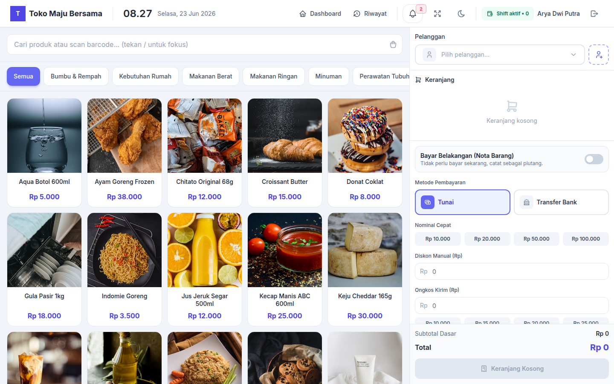
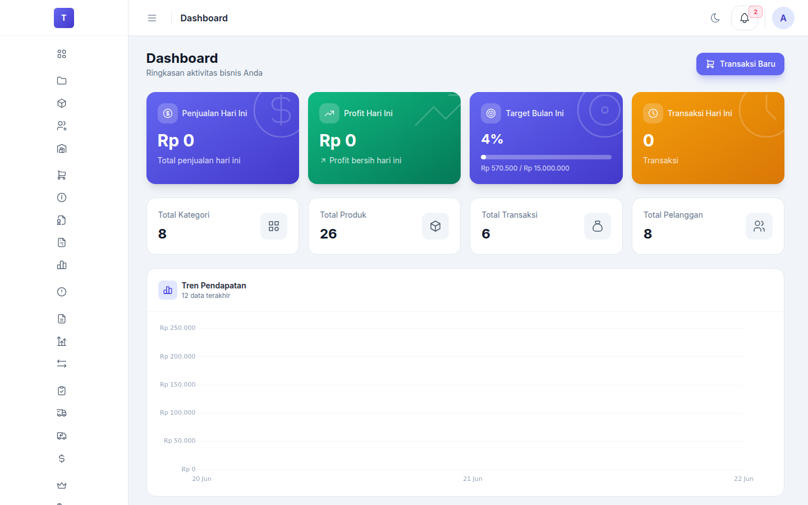
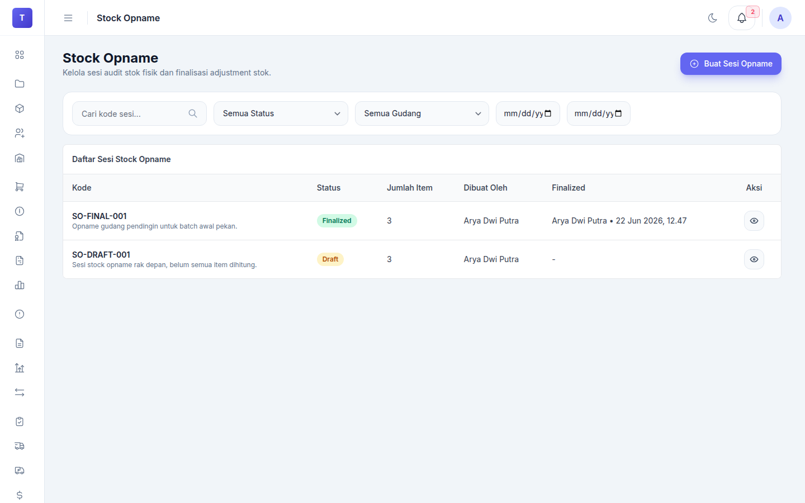
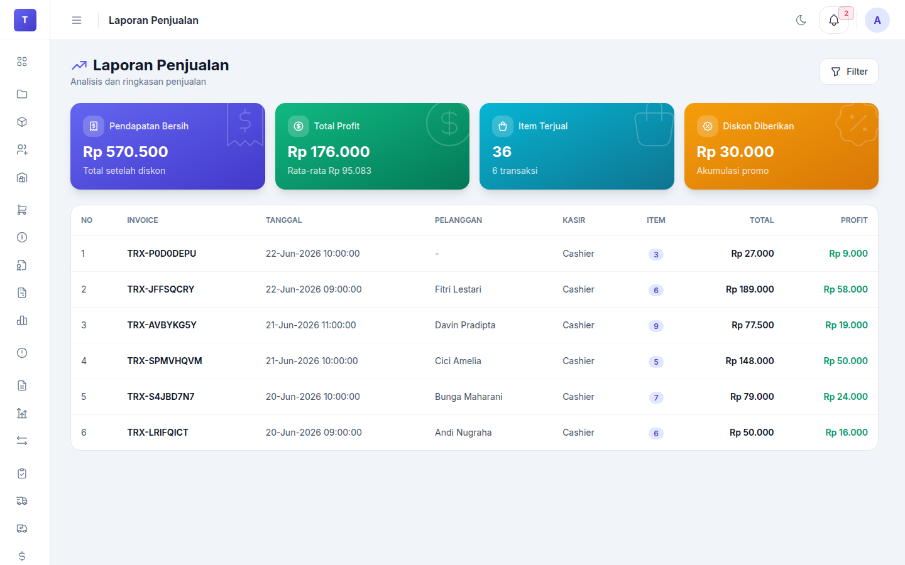

<p align="center">
  
</p>

<h1 align="center">DyskPOS</h1>

<p align="center">An open-source point of sale for Indonesian shops: checkout, inventory across warehouses, purchasing, finance, CRM, and loyalty, with an offline mode.</p>

<p align="center">
  <a href="LICENSE"></a>
  <a href="https://dysklab.fanny.dev"></a>
  <a href="https://buymeacoffee.com/fannydevz"></a>
</p>



DyskPOS runs a shop from the cashier to the books: barcode checkout with several payment methods, stock per
warehouse, purchase orders, receivables and payables, VAT, member tiers and points, and WhatsApp messages to
customers. It keeps selling when the connection drops and syncs when it's back.

> The interface is in Indonesian. DyskPOS is based on [Point of Sales](https://github.com/aryadwiputra/point-of-sales)
> by Arya Dwi Putra.

## Get it

**Requires:** PHP 8.3 or later, Composer, Node.js 22 or later, and MySQL (or SQLite).

```bash
git clone https://github.com/DyskLab/dyskpos.git
cd dyskpos
cp .env.example .env
composer install && PUPPETEER_SKIP_DOWNLOAD=true npm install
php artisan key:generate
php artisan migrate --seed
php artisan storage:link
composer run dev
```

Open http://localhost:8000. There's no default account: the first visit goes to `/setup` to create the admin account
and the store profile. To try it with sample data, run `php artisan seed:demo --force`, which adds outlets, products,
transactions, purchasing, CRM, dine-in tables, and three demo accounts (see [docs/demo-data.md](docs/demo-data.md)).

**WhatsApp gateway (optional):**

```bash
cd whatsapp-service
npm install && npm start
```

## Features

**POS and transactions**
- Product search by barcode or keyword, and a camera barcode scanner (PWA).
- A multi-item cart with hold and resume.
- Cash, bank transfer, Midtrans, Xendit, and pay later.
- Units with automatic stock conversion (pcs, box, kg, carton) and price lists per customer group.
- Promotions (discounts, quantity breaks, bundles, buy X get Y) and discounts that need approval.
- 11% VAT, exclusive or inclusive, thermal printing over WebUSB, and dine-in tables.
- **Offline mode:** transactions queue while offline and sync when back online.

**Inventory and warehouses**
- Products, categories, and barcodes, with stock kept per warehouse or branch.
- Stock transfers (draft → send → receive), stock counts, and mutation history.
- Batches with expiry dates (FEFO), composite products and kits, and reorder points with suggested purchase orders.

**Purchasing and finance**
- Purchase orders, goods receiving with batches, supplier returns, and payables with aging.
- Receivables with partial payments, aging, and collection notes; VAT and income tax.
- A customer portal to see invoices and pay online.

**CRM and loyalty**
- Customers with Indonesian regions, member tiers, points, vouchers, segments, and campaigns.
- **WhatsApp gateway** through whatsapp-web.js (scan a QR code once; the session persists).

**Reports and admin**
- Sales, profit, and insights (by hour, by cashier, repeat customers).
- PDF invoices, receipts (80 mm and 58 mm), shipping labels, and Excel exports.
- Roles and permissions, an audit log with before and after snapshots, and Excel imports.

| Dashboard | Stock count | Sales report |
| --- | --- | --- |
|  |  |  |

All 33 screenshots are in [docs/screenshots.md](docs/screenshots.md).

## REST API

DyskPOS has a token-based REST API (Sanctum) at `/api/v1` for mobile apps and integrations: auth, products,
customers, categories, warehouses, suppliers, and the whole POS flow (`pos/shift`, `pos/cart`, `pos/hold`,
`pos/checkout`, `pos/transactions`). Interactive docs are at `/docs/api` and the OpenAPI spec at `/docs/api.json`.

```bash
curl -X POST http://localhost:8000/api/v1/auth/login \
  -H "Content-Type: application/json" \
  -d '{"email":"admin@example.com","password":"password"}'

curl http://localhost:8000/api/v1/products -H "Authorization: Bearer <token>"
```

## Documentation

| Document | Covers |
| --- | --- |
| [docs/getting-started.md](docs/getting-started.md) | Full setup |
| [docs/demo-data.md](docs/demo-data.md) | Demo seeder and accounts |
| [docs/configuration.md](docs/configuration.md) | Environment, payments, tax, printers, WhatsApp |
| [docs/architecture-overview.md](docs/architecture-overview.md) | Architecture, middleware, services |
| [docs/feature-index.md](docs/feature-index.md) | Every module |

## Troubleshooting

| Problem | Fix |
| --- | --- |
| Permissions look stale after seeding | Sign out and back in |
| Midtrans or Xendit webhooks don't arrive | `APP_URL` must be public, not `localhost` |
| Product images don't show | `php artisan storage:link` |
| A new module returns error 500 | `php artisan migrate` |
| No WhatsApp QR code | Start `whatsapp-service/` (`npm start`) |

## Tech

Laravel 13, Inertia 3, React 19, Tailwind, MySQL, Sanctum, Spatie Permission, and whatsapp-web.js.

## Contributing

Branch from `development`, open the pull request against `development`, and make sure `php artisan test` passes.
See [CONTRIBUTING.md](CONTRIBUTING.md).

## Support

If DyskPOS helps you, you can [buy me a coffee](https://buymeacoffee.com/fannydevz).

## Part of DyskLab

DyskPOS is part of [DyskLab](https://dysklab.fanny.dev), alongside
[DyskFlow](https://github.com/DyskLab/dyskflow), [DyskFocus](https://github.com/DyskLab/dyskfocus),
[DyskFiles](https://github.com/DyskLab/dyskfiles), [DyskStream](https://github.com/DyskLab/dyskstream), and DyskLink
for [Mac](https://github.com/DyskLab/dysklink-mac), [Android](https://github.com/DyskLab/dysklink-android), and
[Windows and Linux](https://github.com/DyskLab/dysklink-desktop).

## License

[GNU AGPL-3.0-only](LICENSE). DyskPOS is a modified version of
[Point of Sales](https://github.com/aryadwiputra/point-of-sales), copyright © 2025 Arya Dwi Putra. If you run a
modified version on a server others use, you must offer them its source code.
